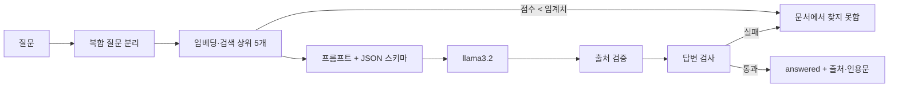

# 구름노트 RAG 챗봇

[](https://youtu.be/cZutHIKw9UI)

▶ [시연 영상 보기 (YouTube)](https://youtu.be/cZutHIKw9UI) — 로컬 CPU 실행이라 답변 대기 구간이 있습니다. 자세한 내용은 [응답 속도](#응답-속도)를 보세요.

가상 제품 "구름노트"의 FAQ·정책 문서 4개만 근거로 답하는 RAG 챗봇입니다.
목표는 많이 답하는 것보다 **문서에 없는 내용을 지어내지 않는 것**입니다. 근거가 약하면 답하지 않고 `문서에서 찾지 못함`을 돌려줍니다.

- 백엔드: FastAPI (`POST /ask`, `X-API-Key` 인증)
- 실행 모드 두 가지
  - **로컬(Ollama)**: 채팅 `llama3.2`, 임베딩 `bge-m3`, 파일 기반 벡터 저장소. 아래 평가 결과는 이 모드에서 측정했습니다.
  - **Azure**: Azure OpenAI + Azure AI Search + App Service + Key Vault. Bicep과 `azd`로 배포합니다.
- 최종 평가(로컬, 83문항): **정확도 97.6%(81/83), 환각 0건**. 처음 보는 질문(holdout)에서는 9/10, 환각 0건

## 1. 동작 방식



1. **복합 질문 분리**: "A는 얼마이고, B는 무엇인가요?"를 모델 호출 없이 규칙으로 나눠 따로 답한 뒤 합칩니다. 한쪽만 답이 없으면 `"B는 무엇인가요?"에 대한 내용은 문서에서 확인되지 않습니다.`로 표시합니다.
2. **검색과 임계치**: 최고 점수가 `MIN_SEARCH_SCORE` 미만이면 모델을 부르지 않습니다. 임계치는 보정용 질문으로 정했습니다(`src/calibrate.py`, 로컬 0.6411).
3. **구조화된 응답**: 모델은 `answerable`, `answer`, `citations[{chunk_id, quote}]` JSON으로 답합니다. `chunk_id`는 스키마의 `enum`으로 이번에 넘긴 근거 ID만 쓸 수 있습니다. `temperature=0`.
4. **출처 검증**: 인용문이 실제 근거 청크에 있는지 확인합니다. 조금 바꿔 옮긴 인용문은 가장 가까운 문서 문장으로 되돌리되, 숫자나 영문이 다르면 되돌리지 않습니다.
5. **답변 검사(fail-closed)**: 아래 중 하나라도 걸리면 답변을 버립니다.

| 검사 | 막는 것 |
|---|---|
| 숫자·영문 대조 | 근거와 질문에 없는 숫자·표기(예: 없는 가격, `AES-128`) |
| 인용문 관련성 | 질문 핵심어가 절반 넘게 들어 있지 않은 인용문, 질문의 한 글자 대상어("팀 요금제"의 "팀")가 없는 인용문 |
| 답변 문장 근거 | 인용문과 질문 어디에도 기대지 않는 문장(지어낸 문장 섞기) |
| 문서에 없는 전제 인정 | "네"로 시작하면서 근거 어디에도 없는 질문 핵심어를 되풀이하는 답("네, 음성으로 입력할 수 있습니다") |
| 예/아니요 판단 | 질문의 숫자가 근거에 없는데 "네/아니요"로 판단하면 판단을 빼고 문서 문장만 보여 줌 |
| 어조 | 정중한 문장(`~니다`, `~세요`)이 아닌 단답은 근거 문장으로 바꾸거나 막음 |

모델이 답을 거부했지만 질문 핵심어 대부분이 든 문서 문장이 있으면 그 문장을 답으로 씁니다. 반대로 답은 맞는데 인용만 잘못 골랐으면 답을 담은 문장으로 출처를 바꿉니다. 막힌 이유(`below_threshold`, `citation_invalid`, `unsupported_fact`, `off_topic_quote` 등)는 요청마다 로그에 남습니다.

자세한 설계는 [`design/architecture.md`](design/architecture.md), 모델·임계치·비용 등 설계 결정과 근거는 [`design/decisions.md`](design/decisions.md), 요구사항 62개와 각 테스트 매핑은 [`design/acceptance.md`](design/acceptance.md)에 있습니다.

## 2. 평가

`src/evaluate.py`가 `data/eval_questions.json`의 질문을 실제 모델로 돌려 `eval_result.json`에 저장합니다. 판정은 자동입니다.

- 답이 있는 질문: `answered`이고 필수 표기(`must_include`)를 모두 포함하며 금지 표현(`forbidden`)이 없어야 정답
- 답이 없는 질문: `not_found`여야 정답. 답하면 **환각**으로 셉니다.
- 통과 기준: 정확도 0.8 이상, 환각 0건 (`tests/test_ac_eval.py`)

### 최종 결과 (2026-11-06, 로컬 llama3.2 + bge-m3)

| 분류 | 내용 | 정답 | 환각 |
|---|---|---|---|
| base | 기본 사실·답이 없는 질문 | 28/28 | 0 |
| compound | 두 가지를 한 번에 묻는 질문 | 5/5 | 0 |
| trap | "~가 없나요?"처럼 문서에 없는 전제를 깐 질문 | 5/5 | 0 |
| trick | "8자 이상이면 되나요?"처럼 틀린 값을 넣은 질문 | 5/5 | 0 |
| seen_holdout | 예전 holdout(규칙 조정에 이미 쓴 질문) | 28/30 | 0 |
| holdout | 규칙 조정 뒤 새로 만든 질문 | 10/10 | 0 |
| 합계 | | **81/83 (97.6%)** | **0** |

**처음 보는 질문 기준 성능은 holdout 9/10입니다.** 위 표의 10/10은 holdout 오답 1건(아래 "미검증 수정")을 보고 규칙을 고친 뒤 다시 잰 값이라, 일반화 성능으로 보지 않습니다.

질문 하나에 40초~1분이 걸립니다(CPU, 로컬 모델). 83문항 전체는 약 90분입니다.

### 개선 과정

규칙을 고칠 때마다 그 근거가 된 holdout은 `seen_holdout`으로 옮기고 새 holdout을 만들었습니다. 같은 질문으로 조정하고 평가하면 수치가 부풀기 때문입니다.

| 회차 | 문항 | 정확도 | 환각 | 새 holdout | 주요 변경 |
|---|---|---|---|---|---|
| 1 | 43 | 35/43 | 2 | – | 출처 검증·숫자 대조·관련성 검사 |
| 2 | 53 | 49/53 | 0 | 6/10 | 인용문 복원, 거부 대체, 단답 처리 |
| 3 | 63 | 59/63 | 1 | 7/10 | 의문사 질문 부분 일치, 출처 교체, `~세요` 인정 |
| 4 | 73 | 70/73 | 1 | 8/10 | 한 글자 대상어, `chunk_id` enum, 값 확인 질문의 "아니요" |
| 5 | 83 | 80/83 | 0 | 9/10 | 문서에 없는 전제를 "네"로 인정하는 답 차단 |
| 6 | 83 | 81/83 | 0 | (미검증) | 묻는 대상이 없는 근거로 답하는 경우 차단 |

기록된 모델 출력을 새 규칙으로 다시 돌려(모델 호출 없이) 이전 회차에서 새로 막히는 정답이 없는지도 매번 확인했습니다.

### 미검증 수정

환각이 아닌 "엉뚱한 답"은 새 holdout 없이 고치고, 기존 질문 전체 재평가와 기록 재생으로만 회귀를 확인합니다. 이런 수정이 쌓이거나 최종 제출 전에 새 holdout으로 한 번에 검증합니다. 환각을 막는 수정은 항상 새 holdout으로 검증합니다.

| 수정 | 계기 | 처음 보는 질문으로 검증 |
|---|---|---|
| 의문사 바로 앞의 묻는 대상("주소는 어디"의 "주소")이 근거 문장에 없으면 막음. 근거의 영문 표기(`Ctrl+N`)로 답하면 예외 | 5회차 holdout "…고객센터 주소는 어디인가요?"에 운영 시간으로 답함 | 아직 안 함 |

## 3. 한계

- **남은 오답 2건** (둘 다 답하지 않는 쪽으로 틀린 과잉 차단)
  - "태그는 어떻게 만드나요?" → 찾지 못함. 핵심어를 어절의 앞 두 글자로 비교해 `만드`(만드나요)와 `만들`(만들어집니다)을 다른 말로 봅니다.
  - "해지하기 전에 무엇을 해 두는 것이 좋나요?" → 찾지 못함. 모델 답은 맞았지만 엉뚱한 문장을 인용해 막혔습니다.
- **미검증 수정 1건**: 위 "미검증 수정"의 규칙은 처음 보는 질문에서 맞는 답을 막는지 아직 확인하지 않았습니다.
- **규칙 기반 검사의 한계**: 형태소 분석 없이 글자 비교만 합니다. 유의어나 활용형이 다르면 과잉 차단되고, 문서에 있는 단어와 숫자로 짝만 틀리게 만든 답이나 "네" 없이 문서에 없는 기능을 인정하는 답은 막지 못합니다. 형태소 분석기(예: Kiwi)를 쓰면 개선할 수 있지만 모든 기준값을 다시 맞춰야 합니다.
- **평가 규모**: 문서 4개, 질문 83개, 자동 판정입니다. 실제 서비스 품질을 대표하지 않으며, 한 번 실행한 결과입니다(`temperature=0`이어도 로컬 모델 출력은 조금 달라질 수 있습니다).
- **대부분의 예/아니요 질문**은 "아니요" 없이 문서 기준 문장으로만 답합니다(값을 확인하는 질문은 예외).
- **속도**: 로컬 CPU 모델이라 질문 하나에 최대 1분이 걸립니다. 아래 "응답 속도"를 보세요.
- **Azure 모드**: 인프라 코드와 배포 테스트는 있지만, 위 평가 수치는 로컬 모드 결과입니다. 실습 후 Azure 리소스는 삭제했습니다.

### 응답 속도

시연과 평가는 노트북 CPU에서 로컬 모델(Ollama, `llama3.2` 3B)로 실행했습니다. 그래서 질문 하나에 **40초~1분**이 걸립니다.

- 검색 점수가 임계치보다 낮은 질문(예: 주제 밖 질문)은 모델을 부르지 않으므로 **몇 초 안에** "찾지 못함"으로 답합니다.
- 복합 질문은 하위 질문마다 모델을 부르므로 그만큼 더 걸립니다.

시간 대부분은 모델이 답을 만드는 데 쓰이고, 답변 검증 로직은 응답 시간에 거의 영향을 주지 않습니다. 이 프로젝트는 속도보다 **근거 없는 답을 내지 않는 것**을 우선했습니다(83문항 평가에서 환각 0건).

**속도를 개선할 수 있는 방법** (측정하지 않은 기대 효과)

| 방법 | 기대 효과 | 고려할 점 |
|---|---|---|
| GPU에서 실행 | 모델 추론이 가장 크게 빨라짐 | 장비 비용. 코드는 바꿀 필요 없음 |
| Azure 모드(Azure OpenAI)로 실행 | 클라우드 모델이라 로컬 CPU보다 빠를 것으로 예상 | 사용량만큼 비용 발생. 같은 코드로 전환되도록 만들어 둠 |
| 모델을 메모리에 계속 올려 두기 (`OLLAMA_KEEP_ALIVE`) | 첫 질문의 모델 로딩 시간 제거 | 메모리를 계속 차지함 |
| 답변 길이 상한 낮추기 (현재 `max_tokens=1000`) | 긴 답을 만드는 시간 감소 | 너무 짧으면 JSON이 잘려 "찾지 못함"이 늘어남 |
| 자주 묻는 질문의 답 캐시 | 같은 질문은 즉시 응답 | 문서가 바뀌면 캐시를 비워야 함 |
| 복합 질문의 하위 질문 동시 처리 | GPU·클라우드에서는 대기 시간 감소 | CPU 한 대에서는 효과가 작음 |
| 더 작은 모델 | 추론 시간 감소 | 정확도가 떨어질 수 있어 83문항 재평가 필요 |

**스트리밍**(답을 만드는 대로 보여 주기)은 이 구조와 맞지 않습니다. 답변 전체와 인용문을 받은 뒤 검사하고 나서야 내보낼 수 있기 때문입니다. 대신 "근거 검색 중 → 답변 검증 중"처럼 진행 상태를 보여 주면 기다리는 느낌을 줄일 수 있습니다.

## 4. 실행 방법

### 로컬 (Ollama)

```powershell
ollama pull llama3.2
ollama pull bge-m3
python -m venv .venv; .\.venv\Scripts\Activate.ps1
pip install -r requirements-dev.txt

# 테스트 화면: 문서를 인덱싱하고 http://127.0.0.1:8765/ 를 엽니다. API 키는 실행할 때마다 새로 만듭니다.
python test_ui/run_ui.py

# 단위 테스트 (모델 호출 없음)
pytest -q

# 실제 모델 평가 (약 90분)
$env:LLM_PROVIDER="ollama"; $env:MIN_SEARCH_SCORE="0.6411"
python src/evaluate.py
$env:EVAL_RESULT="eval_result.json"; pytest -q tests/test_ac_eval.py
```

API로 직접 부르려면 `.env.example`을 `.env`로 복사해 `API_KEY`(32자 이상)를 넣고, `python src/ingest.py`로 인덱스를 만든 다음 `uvicorn main:app --app-dir src`로 띄운 뒤 `X-API-Key` 헤더와 함께 `POST /ask {"question": "..."}`를 보냅니다.

### Azure

```powershell
azd provision          # Azure OpenAI, AI Search, App Service, Key Vault 생성
python src/ingest.py   # 문서 인덱싱
azd deploy             # 앱 배포
```

API 키는 배포 때 보안 파라미터로 Key Vault에 넣고, App Service에는 Key Vault 참조만 둡니다. 앱은 관리 ID로 키를 읽습니다. 참조가 풀리지 않으면 앱이 시작에 실패하도록 했습니다.

## 5. 폴더 구조

| 경로 | 내용 |
|---|---|
| `src/rag.py` | 검색, 프롬프트, 출처 검증, 답변 검사 |
| `src/api.py`, `src/main.py` | FastAPI 앱, 인증, 오류 응답, 요청 로그 |
| `src/providers.py` | Azure / Ollama 공급자 |
| `src/ingest.py` | 문서 청크 분할과 인덱싱 |
| `src/calibrate.py`, `src/evaluate.py` | 임계치 보정, 실제 모델 평가 |
| `data/docs/` | 근거 문서 4개(실습용 가상 제품) |
| `data/eval_questions.json` | 평가 질문 83개 |
| `design/` | 아키텍처, 요구사항(EARS 형식)과 테스트 매핑 |
| `infra/` | Bicep (`main.bicep`, `resources.bicep`) |
| `tests/` | 요구사항별 pytest |
| `test_ui/` | 로컬 테스트 화면(배포 대상 아님) |

## 6. 연락처

이메일: [veryfar@naver.com](mailto:veryfar@naver.com)
