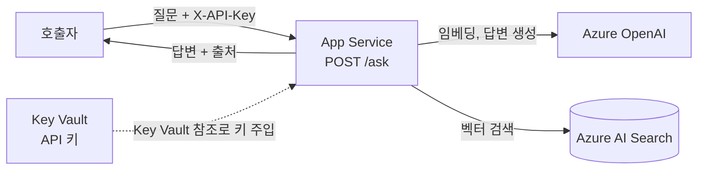
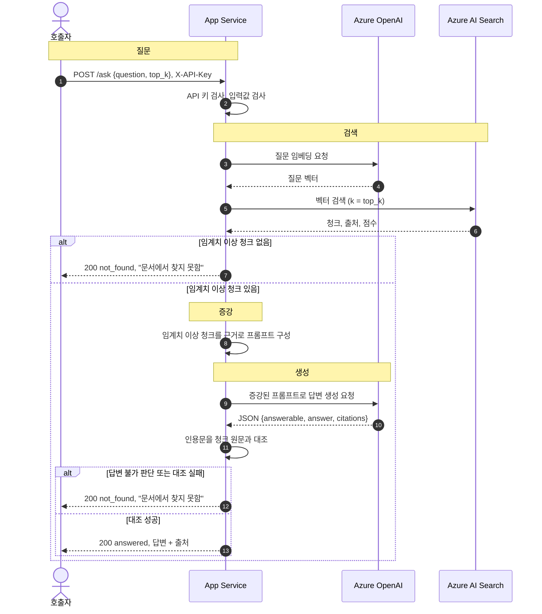
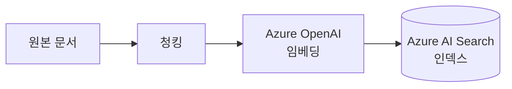

# 아키텍처: Azure 문서 Q&A RAG 챗봇

사용자의 질문에 문서를 근거로 답하고 출처를 함께 돌려줍니다. 근거가 없으면 답을 만들지 않고 `문서에서 찾지 못함`을 반환합니다. 검증 기준은 [acceptance.md](acceptance.md)에 있습니다.

아직 코드와 Azure 리소스는 없는 설계 단계 문서입니다.

## 1. 구성요소

| 구성요소 | 역할 | 데이터 흐름에서 맡는 단계 |
|---|---|---|
| App Service | `POST /ask` API를 제공하고 전체 흐름을 조합 | 질문 접수, 증강, 응답 |
| Azure AI Search | 문서 청크와 벡터를 저장하고 가까운 청크를 반환 | 검색 |
| Azure OpenAI | 질문과 청크를 임베딩하고 답변을 생성 | 검색용 임베딩, 생성 |
| Key Vault | 호출자 확인용 API 키를 보관 | 질문 접수 전 인증에 필요한 값 제공 |



호출자는 App Service만 호출합니다. Azure AI Search와 Azure OpenAI에 직접 접근하지 않습니다. 점선은 요청이 아니라 설정이 전달되는 경로입니다.

## 2. 질의 데이터 흐름: 질문 → 검색 → 증강 → 생성



| 단계 | 처리 | 입력 → 출력 | 근거가 없거나 실패하면 |
|---|---|---|---|
| **1. 질문** | API 키를 먼저 확인한 뒤 본문 형식과 질문 길이를 검사 | HTTP 요청 → 검증된 질문 | 401, 422. 외부 호출 없음 |
| **2. 검색** | 질문을 임베딩하고 Azure AI Search에서 벡터 검색 | 질문 → 청크, 출처, 점수 | 외부 호출 오류는 502, 503, 504 |
| **3. 증강** | 임계치 미만 청크를 버리고, 남은 청크를 구분 기호 안에 데이터로 넣어 프롬프트 구성 | 청크 → 프롬프트 | 남은 청크가 없으면 `not_found`, 생성 호출 없음 |
| **4. 생성** | 근거 안의 내용으로만 답하게 하고, 답변과 인용을 JSON으로 받아 인용문을 원문과 대조하고, 답변의 숫자·영문 표기, 인용문과의 관련성, 정중한 어조를 확인 | 프롬프트 → 답변 + 출처 | 대조 실패는 `not_found`, 근거가 확인된 단답은 그 사실이 든 문서 문장으로 교체, 모델이 거부했어도 질문 핵심어 대부분이 든 문서 문장이 있으면 그 문장으로 답변, 형식 오류는 502 |

근거를 두 번 확인합니다. 증강 전에 점수로 한 번 거르고, 생성 후에 모델의 판단과 인용문으로 한 번 더 확인합니다. 점수는 주제가 비슷한지만 보여 주므로, 같은 주제지만 문서에 답이 없는 질문은 생성 후 확인에서 걸러야 합니다.

**복합 질문:** 물음표나 연결 어미로 이어진 질문은 모델 호출 없이 최대 3개로 나눕니다. 하위 질문마다 2~4단계를 따로 거친 뒤 답변을 합치므로, 모델 호출도 하위 질문 수만큼 늘어납니다. 답이 없는 하위 질문은 답변에 그 사실을 밝힙니다.

**실패 사유 로그:** 요청 로그의 `steps`에 하위 질문별 결과와 최고 점수를 남깁니다(예: `below_threshold@0.6312,answered@0.7458`). 질문 원문은 남기지 않고 응답 본문도 바꾸지 않습니다. 사유 목록은 [acceptance.md](acceptance.md#공통-정의)에 있습니다.

## 3. 호출자 인증

공개 엔드포인트를 아무나 호출해 모델 비용을 일으키지 못하도록 `POST /ask`에 API 키를 요구합니다.

| 항목 | 내용 |
|---|---|
| 전달 방식 | 요청 헤더 `X-API-Key` |
| 검사 시점 | 다른 검사와 외부 호출보다 먼저 |
| 비교 방식 | 시간차로 값을 추측하지 못하도록 상수 시간 비교 |
| 키 보관 | Key Vault 시크릿. App Service 앱 설정에는 Key Vault 참조만 둠 |
| 키 읽기 권한 | App Service의 Managed Identity에 `Key Vault Secrets User` 부여 |
| 키 값 | 32자 이상 임의 값. 코드와 저장소에 두지 않음 |

**참조 해석 실패에 대비합니다.** Key Vault 참조가 해석되지 않으면 App Service는 `@Microsoft.KeyVault(...)` 문자열을 그대로 앱 설정 값으로 넘깁니다. 이 문자열이 그대로 키로 쓰이지 않도록, 키가 비었거나 짧거나 참조 형식이면 앱이 시작에 실패하게 합니다.

**한계:** 호출자 모두가 키 하나를 공유하므로 개별 사용자를 구분할 수 없고, 키가 유출되면 교체 전까지 막을 수 없습니다. 호출량 제한도 없습니다.

## 4. 인덱싱 데이터 흐름

검색이 동작하려면 문서가 먼저 인덱스에 들어가 있어야 합니다. 이 흐름은 사용자 요청과 별도로 실행합니다.



## 5. API 계약

### `POST /ask`

요청 헤더는 `X-API-Key`이고, 본문은 다음과 같습니다.

```json
{"question": "환불 기간은 며칠인가요?", "top_k": 5}
```

`question`은 공백 제거 후 1~1000자입니다. `top_k`는 선택 값으로 1~10 정수이고 기본값은 5입니다.

근거가 있을 때의 응답입니다. `sources`는 답변이 실제로 인용한 청크, `retrieved`는 임계치를 넘은 검색 결과입니다.

```json
{
  "status": "answered",
  "answer": "환불은 구매 후 14일 안에 신청할 수 있습니다.",
  "sources": [
    {"source": "policy.md", "chunk_id": "ab12", "score": 0.78, "quote": "구매 후 14일 안에"}
  ],
  "retrieved": [
    {"source": "policy.md", "chunk_id": "ab12", "score": 0.78}
  ],
  "top_score": 0.78,
  "request_id": "7f3c"
}
```

근거가 없을 때의 응답입니다. 정상 처리 결과이므로 오류가 아닌 HTTP 200입니다.

```json
{
  "status": "not_found",
  "answer": "문서에서 찾지 못함",
  "sources": [],
  "retrieved": [],
  "top_score": 0.51,
  "request_id": "7f3d"
}
```

검색 결과가 하나도 없으면 `top_score`는 `null`입니다.

### 오류 응답

모든 오류는 같은 형식이며 내부 예외 내용을 담지 않습니다.

```json
{"error": {"code": "UPSTREAM_TIMEOUT", "message": "요청 시간이 초과되었습니다.", "request_id": "7f3e"}}
```

| 상태 | `code` | 상황 |
|---|---|---|
| 401 | `UNAUTHORIZED` | API 키 없음 또는 불일치 |
| 422 | `INVALID_REQUEST` | 본문 형식, 질문 길이, `top_k` 오류 |
| 500 | `INTERNAL_ERROR` | 예상하지 못한 내부 오류 |
| 502 | `UPSTREAM_ERROR` | 외부 서비스가 429와 시간 초과 외의 오류를 반환 |
| 502 | `MODEL_OUTPUT_INVALID` | 모델 출력이 약속한 JSON이 아님 |
| 503 | `UPSTREAM_BUSY` | 외부 서비스의 429 |
| 504 | `UPSTREAM_TIMEOUT` | 외부 서비스 호출 시간 초과 |

### `GET /health`

인증과 외부 호출 없이 `{"status": "ok"}`를 반환합니다. 프로세스 생존만 확인하므로 Azure 연결 상태는 알 수 없습니다.

## 6. 아직 정하지 않은 것

`infra/main.parameters.json`에는 6주차에서 가져온 값이 들어 있습니다. 아래 항목은 배포 전에 다시 확인합니다.

| 항목 | 정하는 시점과 방법 |
|---|---|
| 채팅, 임베딩 모델과 배포 유형 | 배포 전. 모델 목록, 구독 할당량, **배포 유형별 종료일**을 함께 확인 |
| 지역, App Service와 AI Search 등급 | 모델 가용성과 비용을 확인한 뒤 |
| 근거 임계치 `MIN_SEARCH_SCORE` | 임베딩 모델과 문서가 정해진 뒤 보정. 다른 프로젝트의 값을 가져오지 않음 |
| Azure OpenAI, AI Search 접근 인증 | Managed Identity를 우선 검토. Key Vault 참조에는 이미 Managed Identity를 사용 |
